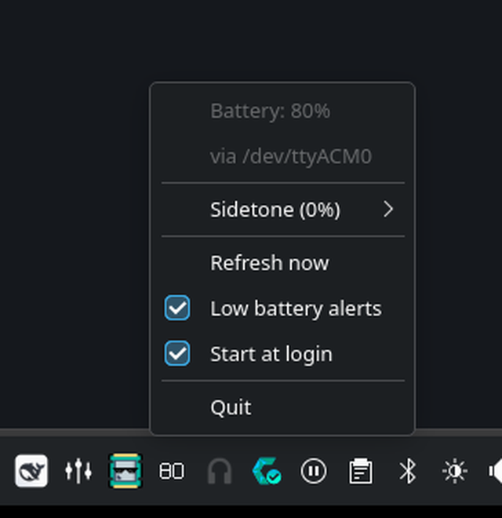
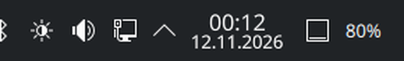

# GSP 370 Tray

A small Linux tray application for the **Sennheiser/EPOS GSP 370** wireless
headset. It shows the headset battery percentage, lets you set sidetone from
the tray menu, and warns when the battery is low.

The app talks to the GSP 370 dongle directly over its CDC-ACM serial interface.
It does not need Qt, GTK, a web view, or an audio server.

[](https://aur.archlinux.org/packages/gsp370-tray)

## Screenshots



*Battery status, sidetone, alerts and startup controls in the tray menu. The
menu header repeats the battery and device information from the tooltip, which
is dismissed when the menu opens.*



*The optional KDE Plasma 6 panel widget.*

## Features

### Battery monitoring

- Battery percentage in the tray icon and tooltip
- Transparent icon whose text adapts to light and dark panels
- Low-battery notifications at 20 %, 10 % and 5 %
- Headset on/off detection and automatic reconnection

### Sidetone control

- Ten-percent steps from the tray menu
- Scriptable `--set-sidetone` for a specific percentage
- The menu remembers the last menu-selected value; see the read-back
  limitation below

### Desktop integration

- StatusNotifierItem tray (tested on KDE Plasma 6)
- Optional KDE Plasma 6 panel widget that renders the percentage as native
  panel text
- Start-at-login toggle

### Automation and lightweight operation

- Scriptable CLI: `--battery`, `--probe`, `--status`, `--set-sidetone`
- Machine-readable status for scripts and the Plasma widget
- Small native Rust binary; no Qt, GTK, web view, audio processing, separate
  daemon or network service

## Requirements

**Required**

- Linux with a StatusNotifierItem-compatible tray host. The app is developed
  and tested on KDE Plasma 6 with CachyOS; other compliant hosts may work but
  are not tested.
- A Sennheiser/EPOS GSP 370 headset and its USB dongle (`1395:009a`). Other
  headset models are not supported.
- Read/write access to the dongle's CDC-ACM serial interface. The packaged
  udev rule grants this to the active seat; systems without logind can use the
  `uucp` group instead.
- A running D-Bus session for StatusNotifierItem.

**Optional**

- `notify-send` from `libnotify` for low-battery notifications. The app works
  without it; only the notifications are skipped.
- KDE Plasma 6 and `plasma-workspace` for the optional panel widget.

## Install

### Arch Linux / CachyOS (AUR)

```bash
paru -S gsp370-tray
# or
yay -S gsp370-tray
```

The package installs the tray app, udev rule, desktop entry and Plasma widget.
Replug the dongle once if the tray reports a permission error after install.

See [Installation](docs/installation.md) for package contents, updates and
uninstallation.

### Prebuilt release

Download the latest archive and `SHA256SUMS` from
[GitHub Releases](https://github.com/NasirA1991/gsp370-tray/releases), verify
the archive, unpack it, and follow the included `INSTALL.txt`:

```bash
VERSION=2.2.2  # replace with the latest release
curl -fLO "https://github.com/NasirA1991/gsp370-tray/releases/download/v$VERSION/gsp370-tray-$VERSION-x86_64.tar.gz"
curl -fLO "https://github.com/NasirA1991/gsp370-tray/releases/download/v$VERSION/SHA256SUMS"
sha256sum -c --ignore-missing SHA256SUMS
tar -xzf "gsp370-tray-$VERSION-x86_64.tar.gz"
```

The archive contains the binary, desktop file, icon, udev rule, Plasma widget,
documentation and licences. The prebuilt binary is for x86_64 Linux.

### Build from source

Requirements: Rust 1.89 or newer and a C linker. `make` and Python 3 are only
needed for the optional helper targets and pseudo-terminal tests.

```bash
git clone https://github.com/NasirA1991/gsp370-tray.git
cd gsp370-tray
./scripts/install.sh
```

`scripts/install.sh` builds with Cargo as your user, then asks for sudo to
install under `/usr/local`. It also installs the desktop files, Plasma widget
and udev rule. Use `PREFIX=/usr ./scripts/install.sh` to install somewhere
else. The normal installer should not be started with `sudo`;
`sudo ./scripts/install.sh --system` is only for installing a binary you have
already built.

For the full source-build and manual-install instructions, see
[Installation](docs/installation.md).

## Usage

Start the tray:

```bash
gsp370-tray
```

Click the tray icon for the menu. It shows the current state, sidetone options
in 10 % steps, refresh, low-battery alerts, start-at-login and quit. Settings
are stored in `$XDG_CONFIG_HOME/gsp370-tray/config` (normally
`~/.config/gsp370-tray/config`).

Command-line examples:

```bash
gsp370-tray --battery          # print the percentage
gsp370-tray --probe            # show device, link state and battery
gsp370-tray --status           # cached status, with a probe fallback
gsp370-tray --set-sidetone 30  # 0 = off, 100 = maximum
gsp370-tray --device /dev/serial/by-id/usb-... --battery
```

For scripts, prefer `--status`: it reads the tray's short-lived status cache
and only opens the serial port when the cache is missing or stale. See the
[CLI and configuration reference](docs/usage.md#command-line-interface) for
output fields and exit codes.

Sidetone has no hardware read-back: the headset cannot report its actual
level. The tray menu therefore shows only the last value selected from that
menu. `gsp370-tray --set-sidetone 30` changes the headset, but it does **not**
update the menu's saved value. Resetting the headset or changing sidetone from
another host can make the displayed value stale. Sidetone is audible only
while the microphone is in use.

### KDE Plasma widget

The package includes an optional Plasma 6 widget. Right-click the panel, choose
**Enter Edit Mode** → **Add Widgets**, and add **GSP 370 Battery**. It refreshes
once a minute, hides while the headset is off, and shows `!` when it cannot
reach the dongle.

See [Usage](docs/usage.md#kde-plasma-widget) for details.

## How it works

The tray runs as a single process: a StatusNotifierItem endpoint and one serial
worker that talks to the dongle. It does not need a separate daemon, a network
service, an audio server, Qt or GTK, or a custom kernel module; it uses the
standard CDC-ACM driver.

The optional Plasma widget calls `gsp370-tray --status`, which reads a
short-lived runtime cache written by the tray instead of opening the serial
port concurrently. See [Architecture](docs/architecture.md) for the modules
and polling details.

## Limitations

- Only the GSP 370 with USB ID `1395:009a` is supported. Other Sennheiser/EPOS
  models have not been tested and are not claimed to work.
- The tray uses StatusNotifierItem. Desktops without an SNI host will not show
  the icon.
- Hiding the icon while the headset is off depends on KDE's **Only show when
  relevant** system-tray setting. Other tray hosts may keep the icon visible.
- Sidetone cannot be read back from the headset. The tray stores only the value
  saved from its menu and cannot verify the headset's actual level.
- The app does not expose charging state, firmware version, equalizer,
  surround processing, microphone processing or firmware updates.
- The Windows suite's equalizer is host-side audio processing, not a GSP 370
  setting; this app does not replace the full Windows audio suite.
- The prebuilt release archive is x86_64 only. The AUR package declares both
  x86_64 and aarch64, but only x86_64 release artifacts are built; source builds
  are not tied to x86_64.

## Troubleshooting

Start with the non-interactive checks:

```bash
lsusb -d 1395:009a
ls -l /dev/ttyACM*
gsp370-tray --probe
gsp370-tray --status
```

`--probe` reports the serial device, link state and battery. `--status`
distinguishes `off` (dongle working, headset not reachable) from `no-dongle`,
`permission`, `error` and `unknown`.

If `--status` reports `permission`, install the udev rule and replug the
dongle. The AUR and source commands, the `uucp` fallback and full diagnostic
steps are in [Troubleshooting](docs/troubleshooting.md#permission-denied) and
[Installation](docs/installation.md#dongle-permissions). Do not run the tray
itself as root.

If the tray icon is missing, confirm that a StatusNotifierItem host is running
and look in the system tray's overflow menu. A desktop without SNI support
cannot display the icon.

## Documentation

| Document | Contents |
|---|---|
| [Installation](docs/installation.md) | AUR, release archive, source build, manual paths, permissions, uninstall |
| [Usage and CLI](docs/usage.md) | Tray menu, CLI reference, configuration, environment variables, Plasma widget |
| [Troubleshooting](docs/troubleshooting.md) | Permission, dongle, tray, widget, sidetone and notification problems |
| [Architecture](docs/architecture.md) | Process model, modules, status cache and test strategy |
| [Protocol notes](docs/protocol.md) | Reverse-engineered serial framing, commands and evidence |
| [Contributing](CONTRIBUTING.md) | Development setup, tests, pull requests and releases |
| [Security](SECURITY.md) | Supported versions and private vulnerability reporting |
| [Changelog](CHANGELOG.md) | Release history |

## Contributing and support

Bug reports and feature requests are welcome in the
[issue tracker](https://github.com/NasirA1991/gsp370-tray/issues). Include the
output of `gsp370-tray --probe` and your installation method when reporting a
device problem. Before opening a pull request, see
[Contributing](CONTRIBUTING.md).

## License

The application is licensed under the MIT License. The embedded Noto Sans
Medium digit subset is licensed under the SIL Open Font License 1.1; see
[`rust/assets/NotoSans-OFL.txt`](https://github.com/NasirA1991/gsp370-tray/blob/main/rust/assets/NotoSans-OFL.txt).
Packaged installs place it under `/usr/share/licenses/gsp370-tray/`; source
installs use `<prefix>/share/licenses/gsp370-tray/`.

GSP 370 Tray is not affiliated with or endorsed by EPOS, Sennheiser or Demant.
